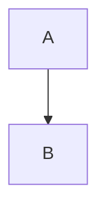

# Round trip

A paragraph with **bold**, *emphasis* and `inline code`.

| Feature | Status |
| ------- | ------ |
| Tables  | kept   |
| Math    | kept   |

```ts
const answer: number = 42;
```

$$
E = mc^2
$$



Term
:   Definition of the term.

The end.
